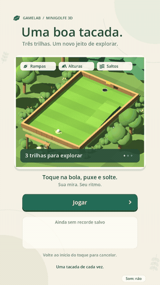

# GameLab Minigolfe 3D

Protótipo jogável em **Godot 4.6.3 e GDScript**, com cenários de bosque, terraços e lagoa, câmera próxima que acompanha a bola e três percursos com rampas, alturas e pequenos saltos. Toque perto da bola, puxe para definir direção e força e solte para lançar. O objetivo é concluir com o menor total de tacadas.

A versão **0.3.0** reformula a apresentação a partir das filmagens, com vegetação, materiais, água animada, rastro, captura e sons sintetizados próprios. Veja as [referências e decisões](docs/REFERENCIAS_VISUAIS.md).

Inclui menu, controle por mouse/toque, mira e potência, colisões e rebotes, retorno de área fora de jogo, resultado, repetição, confirmação de abandono e recorde local. A partida funciona offline. A distribuição permanece privada.



## Abrir e jogar

Instale o Godot **4.6.3 padrão**, importe [project.godot](project.godot) no editor e pressione **F5** para executar. Não é necessário instalar pacotes, backend ou fornecer credenciais.

No terminal, com `godot` disponível:

```sh
cd game-lab-dev
sh scripts/dev.sh import
sh scripts/dev.sh run
```

Para abrir o editor: `sh scripts/dev.sh editor`. O launcher confere a versão e prepara dados, configuração e cache em `.runtime/`, ignorado pelo Git. Variáveis XDG já definidas são preservadas. Abrir diretamente pelo editor usa os diretórios padrão da engine.

No **Windows**, o caminho principal é importar `project.godot` pelo editor e usar F5. Para testes no PowerShell, a partir da pasta do projeto, use o executável console do Godot, sem depender de `sh`:

```powershell
$godot = 'C:\Ferramentas\Godot\Godot_v4.6.3-stable_win64_console.exe'
& $godot --headless --path . --import
& $godot --headless --path . --script tests/run_tests.gd
& $godot --path .
```

Adapte o caminho do executável à sua instalação. Os arquivos temporários de teste usam o diretório de cache informado pela engine, sem exigir `/tmp`. A execução desta entrega foi validada em Linux; Windows e macOS ainda não foram executados.

O jogo salva apenas o melhor total em `user://record_3d.json`. Um recorde não salvo é identificado na interface; falhas preservam o arquivo anterior. Arquivos com versão desconhecida permanecem intactos. Fechar descarta a sessão em andamento e os resultados apenas em memória.

O recorde do protótipo plano permanece no arquivo anterior; os resultados dos mapas com alturas são guardados separadamente. Os saltos acontecem ao sair das rampas com força suficiente, sem botão adicional.

## Controles

- Clique/toque perto da bola, arraste e solte. A bola vai no sentido contrário ao arraste.
- Volte ao início do gesto para cancelar. A mira reaparece quando a bola para.
- Menu ou Esc abre a confirmação; Continuar conserva a sessão e Voltar ao menu a encerra.
- **Visão geral / Seguir bola** alterna a câmera. Ela permanece imóvel durante a mira; alternar cancela o gesto sem contar tacada.
- **Som: sim / Som: não** ativa ou silencia os efeitos.
- Perda de foco ou suspensão pausa a sessão, cancela a mira e interrompe o som. Recuperar o foco não fecha uma confirmação aberta.

## Testar e gerar o pacote

```sh
sh scripts/dev.sh test
sh scripts/dev.sh build
```

A suíte executa **292 verificações** (229 regressões anteriores, 31 verificações específicas de 3D e 32 de câmera, gestos e áudio) de entrada na cena real, pontuação, física, pausas, JSON e falhas de gravação. Inclui uma regressão para impedir tacada involuntária ao redimensionar a janela durante a mira. Usa registros temporários isolados e retorna código diferente de zero em caso de falha.

O build produz `builds/gamelab.pck`, sem testes ou documentação. É um pacote que requer Godot 4.6.3, sem executável independente. Para jogá-lo:

```sh
godot --main-pack builds/gamelab.pck
```

A exportação com executável independente exige os templates oficiais compatíveis. Nenhuma exportação iOS foi feita.

## Validação gráfica na nuvem

No ambiente preparado, Xvfb permite testar a janela nativa sem publicar uma página:

```sh
sh scripts/cloud-display.sh
DISPLAY=:99 XAUTHORITY=/workspace/.runtime/xvfb/Xauthority LIBGL_ALWAYS_SOFTWARE=1 sh scripts/dev.sh capture
```

O teste controla o cenário 3D por eventos de mouse, joga os três percursos, confirma o recorde, grava oito imagens em `.runtime/captures/` e encerra. Em um computador com display, basta `sh scripts/dev.sh capture`.

Para manter o jogo aberto no display virtual, use os mesmos prefixos com `sh scripts/dev.sh run`. Display e jogo precisam ser reiniciados em outra tarefa; não dependem de servidor web.

## Documentação e estrutura

| Arquivo | Responsabilidade |
| --- | --- |
| [GDD v0.4](docs/GDD.md) e [conversão 3D](docs/CONVERSAO_3D.md) | Escopo, regras, mapas e parâmetros |
| [Mecânicas](docs/MECANICAS.md) e [telas](docs/TELAS.md) | Comportamento e interação |
| [Critérios](docs/CRITERIOS_ACEITACAO.md) | AC-01 a AC-40 e métodos por plataforma |
| [Referências visuais](docs/REFERENCIAS_VISUAIS.md) | Observações das filmagens e decisões de apresentação próprias |
| [Validação 3D](docs/VALIDACAO_3D.md) | Evidências, comandos e limitações da versão atual |
| [Roadmap](docs/ROADMAP.md) | Avaliação e teste privado no iPhone |
| [Configuração](scripts/game_config.gd) e [mapas](scripts/courses.gd) | Parâmetros centralizados e percursos como dados |
| [Sessão](scripts/golf_session.gd) e [física 3D](scripts/physics_3d.gd) | Estados, gravidade, colisões nativas e pontuação |
| [Cenário 3D](scripts/course_view_3d.gd) e [interface](scripts/main.gd) | Terrenos, câmera, bola e interface sobre o cenário |
| [Recorde](scripts/record_store.gd) | Validação e substituição atômica do arquivo |

Usar o checkout existente em `/workspace/game-lab-dev` nas tarefas em nuvem. Cada tarefa já é isolada; não criar worktree sem solicitação explícita.

## Limites da entrega

O fluxo principal e o PCK foram verificados em Linux/Godot 4.6.3. A suíte também passou com criação de sockets bloqueada. As imagens nativas de menu, mira, confirmação, mapas, captura e resultado foram inspecionadas.

**Pendentes:** avaliação humana da jogabilidade, calibração e testes no iPhone real de toque, área segura, suspensão, desempenho e persistência. A exportação iOS requer macOS/Xcode, templates e assinatura; Linux não comprova funcionamento no aparelho.

Multiplayer, bots, contas, monetização e Android ficam fora do MVP. Sons, câmera e direção artística desta revisão precisam de avaliação humana e calibração no aparelho.
