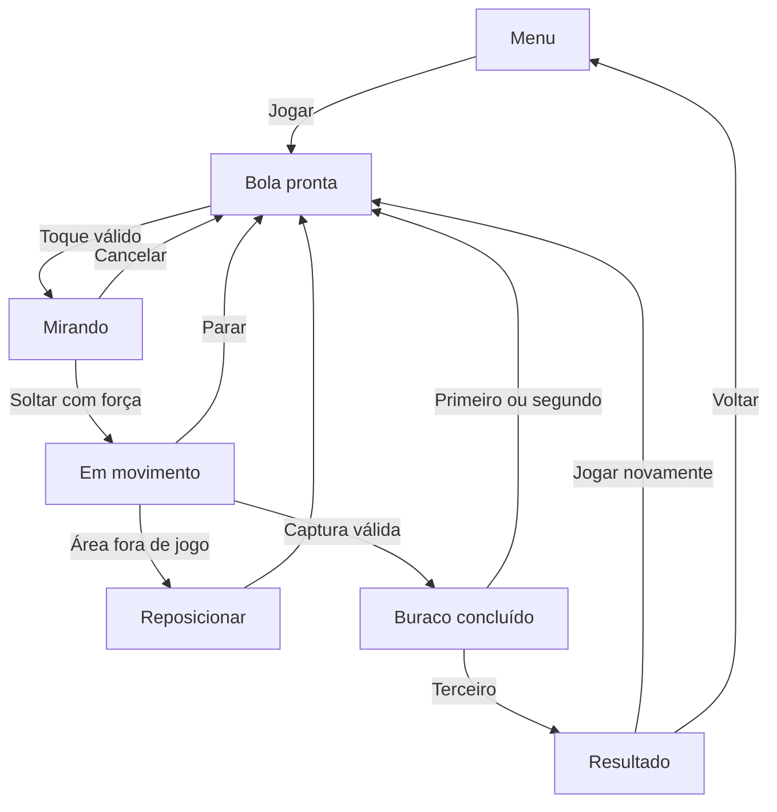

# GameLab — documento de concepção do jogo

**Revisão visual:** o projeto 0.3.0 incorpora cenários completos, câmera próxima e efeitos próprios a partir das filmagens. [Referências e decisões](REFERENCIAS_VISUAIS.md). A revisão 3D anterior incorpora rampas, pisos elevados e pequenos saltos. [Alturas e regras 3D](CONVERSAO_3D.md) · [Resultados da versão atual](VALIDACAO_3D.md).

**Versão:** 0.4 · 14/10/2026  
**Fase:** 4 — protótipo construído; avaliação em andamento  
**Nome de trabalho:** GameLab Minigolfe  
**Situação:** protótipo 3D Godot 4.6.3 com rampas e saltos, verificado em Linux; avaliação humana e testes no iPhone pendentes. Veja o [relatório de validação](VALIDACAO_3D.md).  
**Base:** `GameLab_Analise_Videos_02_Planejamento.md`, versão 4, e `GameLab_Prompts_Passo_a_Passo.md`.

Esta revisão parte exclusivamente do GDD v0.1 enviado pelo usuário. Os documentos citados como base não acompanharam esta entrega. O GDD e a [revisão 3D](CONVERSAO_3D.md) definem o pacote atual; mecânicas, telas e critérios detalham suas regras. As alterações da v0.2 estão registradas ao final.

## 1. Conceito e objetivo

Criar um minigolfe original em que o jogador toca perto da bola, puxa para definir direção e força e solta para lançar. A graça está em dosar a tacada e usar a geometria do percurso para alcançar o buraco com poucas tentativas.

A primeira versão será offline, para uma pessoa, com três percursos em sequência. Ela deve permitir avaliar o controle, os rebotes e a clareza das regras antes de investir em mais fases ou sistemas comerciais.

O primeiro alvo de uso é o iPhone. O computador, com mouse, será usado durante o desenvolvimento. Android fica para uma etapa posterior. A distribuição permanece privada até uma instrução explícita para publicar ou compartilhar.

### Origem das informações

| Categoria | O que orienta este documento |
| --- | --- |
| Observado na referência | Preparação visual da mira, intensidade variável, lançamentos, rebotes, conclusão de buracos, pontuação acumulada e três percursos nas partidas examinadas |
| Inferido na análise | O arraste provavelmente aponta em sentido contrário ao lançamento; a referência aparenta usar retorno a uma posição segura após a queda |
| Desconhecido na referência | Curva de força, coeficientes físicos, penalidades, efeito quantitativo dos equipamentos, regras de empate e funcionamento da rede |
| Decisão para o nosso protótipo | As regras, os números, os mapas, a interface e o salvamento definidos nas próximas seções |

**Todas as escolhas das próximas seções são decisões de projeto.** Elas não representam valores internos recuperados do jogo de referência.

## 2. Decisões de escopo

| Item | Definição nesta versão |
| --- | --- |
| Tecnologia planejada | Godot 4.6.3 e GDScript; versão fixada na implementação |
| Apresentação | 3D, câmera ortográfica inclinada, interface vertical |
| Jogadores | Um jogador, sem adversários |
| Conexão | Toda a partida e o recorde local funcionam offline |
| Sessão | Três percursos originais, sempre na mesma ordem |
| Objetivo | Concluir os três buracos com o menor total de tacadas |
| Equipamento | Mesma bola e mesmos parâmetros em todos os mapas |
| Progresso | Melhor total pessoal salvo localmente |
| Encerramento | Conclusão dos três percursos ou abandono pelo menu |
| Limite de tempo | Sem contagem regressiva e sem derrota por tempo |
| Identidade | Formas, cores, mapas, textos e efeitos próprios |

A revisão 0.3 atende ao pedido de rampas, alturas e pequenos saltos em 3D. Os três mapas mantêm sua grade de navegação e ganham pisos com colisão, níveis elevados e um vão com água. As alturas e a física estão detalhadas na [conversão 3D](CONVERSAO_3D.md). Água com transporte vertical permanece fora do escopo.

### Dentro da primeira versão

- Menu, instrução curta e acesso a jogar.
- Mira, ajuste de força, cancelamento e lançamento.
- Frenagem, paredes, obstáculos e rebotes.
- Captura no buraco e retorno após entrar em uma área fora de jogo.
- Três percursos, contagem de tacadas, resultado e repetição.
- Melhor total pessoal, leitura e gravação local.
- Adaptação da apresentação e do toque à área segura da tela.
- Tratamento de interrupção do aplicativo durante uma interação.

### Etapas posteriores

Multiplayer, bots, salas, contas, ranking online, equipamentos com atributos, moedas, baús, loja, compras, anúncios, clãs e eventos. Água com transporte e vento continuam para uma revisão posterior; altura, rampas e salto já pertencem a esta versão. Música e polimento sonoro não bloqueiam a avaliação inicial.

## 3. Ciclo da partida e estados

O jogador inicia a sessão, joga o primeiro percurso até encaçapar a bola, avança para o segundo e para o terceiro e recebe o resultado. Durante cada percurso, repete a sequência de mirar, lançar e esperar a bola parar.



| Estado | Interações permitidas |
| --- | --- |
| Menu | Iniciar uma nova sessão e ler a instrução |
| Bola pronta | Começar uma mira ou abrir a confirmação para voltar ao menu |
| Mirando | Ajustar o arraste, cancelar, soltar ou abrir a confirmação por uma ação independente de menu; somente um dedo controla a mira |
| Em movimento | Acompanhar a bola ou abrir a confirmação para voltar ao menu; toques na bola não geram outra tacada |
| Reposicionar | Mostrar um retorno breve e restaurar a posição anterior ao lançamento; entrada de jogo e menu indisponíveis até terminar |
| Buraco concluído | Bloquear novas tacadas e menu, registrar o resultado do buraco e avançar uma única vez após o feedback |
| Resultado | Ler os três resultados, repetir a sessão ou voltar ao menu |

Ao mudar de percurso, carregar a nova posição inicial e manter o contador atual em zero, pois ele já foi zerado na captura. A sessão conserva as tacadas dos percursos já concluídos.

Confirmação de abandono e suspensão do aplicativo são camadas de pausa sobre o ciclo acima. Não contam como conclusão nem apagam a sessão. As condições de retomada estão na seção 8.

## 4. Controles e mira

### Gesto principal

1. Com a bola pronta, um toque a até **72 unidades lógicas** do centro inicia a mira. A posição inicial do toque é registrada.
2. O arraste é a diferença entre a posição atual e a posição inicial desse toque. O lançamento aponta no sentido contrário ao arraste.
3. A bola permanece parada durante a preparação. Uma seta mostra direção e intensidade, acompanhada de uma barra e de um percentual.
4. Ao soltar fora da zona neutra, registrar a posição anterior à tacada, contar uma tacada e aplicar a velocidade inicial.
5. Ao soltar dentro da zona neutra, cancelar sem movimento e sem alterar a pontuação.
6. A nova mira fica disponível somente depois de a bola parar segundo o critério da seção de física.

**Instrução do jogo:** “Toque perto da bola, puxe e solte para lançar.” Complemento: “Puxe mais para aumentar a força. Volte ao ponto inicial do toque para cancelar.”

### Regra inicial de intensidade

Se o arraste tiver comprimento `d`, a potência normalizada será `(d − 12) / 168`, limitada entre 0 e 1. Arrastes de até 12 unidades pertencem à zona neutra; a potência chega ao máximo em 180 unidades. A velocidade inicial é a direção de lançamento multiplicada pela potência e pela velocidade máxima.

Exemplos iniciais:

| Arraste | Potência | Velocidade inicial |
| --- | ---: | ---: |
| Até 12 unidades | 0% | Sem lançamento |
| 54 unidades | 25% | 250 unidades/s |
| 96 unidades | 50% | 500 unidades/s |
| 138 unidades | 75% | 750 unidades/s |
| 180 unidades ou mais | 100% | 1.000 unidades/s |

Esses valores serão ajustados após jogar o protótipo. A curva linear é uma escolha inicial, não uma conclusão sobre a referência.

### Retorno visual

- A seta aponta somente a direção inicial; não prevê todo o caminho nem os rebotes.
- A barra e o percentual permitem entender a intensidade sem depender apenas da cor.
- Usar ciano até 33%, amarelo entre 34% e 66% e laranja a partir de 67% para a apresentação arredondada da potência.
- A zona neutra não mostra seta de lançamento.
- Após começar uma mira, esse dedo mantém o controle até soltar ou cancelar, mesmo que passe por uma região da interface.
- Passar ou soltar esse arraste sobre o botão de menu não o ativa. Uma ação independente e deliberada de menu — novo toque/clique no botão ou comando de teclado — pode cancelar a mira e abrir a confirmação. Outros dedos não controlam a mira nem lançam a bola.

### Casos que não produzem tacada

Toque fora da região de início, dedo adicional, toque durante movimento, soltura na zona neutra e perda de foco enquanto a mira é preparada. O mouse deve reproduzir as mesmas regras com pressionar, arrastar e soltar.

Cada gesto produz no máximo um lançamento, incluindo plataformas que emulam eventos de mouse a partir do toque. Após cancelamento, troca de estado ou retomada do aplicativo, ignorar a soltura do gesto anterior; um novo gesto precisa começar com um novo pressionamento válido.

## 5. Física e parâmetros iniciais

A grade lógica organiza a navegação e o controle. Cada 100 unidades corresponde a 1 metro; X/Y da grade viram X/Z no mundo 3D, enquanto Y no mundo mede altura. A câmera projeta o toque no plano da altura atual da bola. A interface usa a referência de 720 × 1280.

| Parâmetro | Valor inicial | Uso |
| --- | ---: | --- |
| Área lógica de referência | 720 × 1280 | Composição vertical |
| Atualização física pretendida | 60 passos/s | Base para a primeira implementação |
| Raio da bola | 14 unidades | Colisões e desenho |
| Região para começar o toque | Raio de 72 unidades | Facilitar o controle pelo dedo |
| Zona neutra de arraste | 12 unidades | Cancelar ou ignorar um gesto pequeno |
| Arraste máximo útil | 180 unidades | Limitar a potência |
| Velocidade inicial máxima | 1.000 unidades/s | Tacada com potência máxima |
| Desaceleração em campo livre | 500 unidades/s² | Reduzir gradualmente a velocidade |
| Coeficiente de rebote | 0,78 | Reduzir a componente normal da velocidade após impacto |
| Limiar de parada | 12 unidades/s | Iniciar confirmação de repouso |
| Confirmação de parada | 0,12 s | Evitar liberar uma tacada por oscilação breve |
| Raio de captura do buraco | 22 unidades | Distância entre o centro da bola e o centro do alvo |
| Velocidade máxima de captura | 150 unidades/s | Exigir aproximação suficientemente lenta |
| Feedback de conclusão | Aproximadamente 0,7 s | Dar tempo para perceber a captura antes de avançar |

### Movimento

Aplicar frenagem horizontal de 5 m/s² enquanto a esfera está apoiada. A gravidade é 9,8 m/s² e afeta o movimento nas rampas e no ar. No ar não há frenagem de piso; conservar a componente vertical adquirida ao sair da rampa. Aterrissar desliza sobre o piso; não adicionar um impulso de salto por botão. As colisões usam o corpo e os pisos 3D reais.

Em um impacto com uma parede, refletir a componente normal da velocidade e multiplicá-la por 0,78. Preservar a componente tangencial naquele impacto; a desaceleração continua sendo aplicada. A detecção deve impedir atravessar paredes, inclusive na potência máxima.

Se a esfera estiver apoiada e sua velocidade horizontal permanecer abaixo do limiar durante o intervalo definido, zerar a velocidade e liberar a bola. O início de uma mira nunca deve conservar uma velocidade residual.

### Captura

Capturar com a esfera apoiada na altura do buraco, a até 22 unidades na grade e com velocidade horizontal de até 150 unidades/s. Passar por cima no ar não captura. A captura bloqueia a entrada, interrompe o movimento e registra o contador daquele percurso uma única vez. Na mesma transição, guardar o valor para o feedback, acrescentá-lo aos resultados e zerar o contador atual. O feedback lê o resultado registrado, sem alterar a pontuação.

O alvo é uma região de captura, sem uma parede circular adicional. Uma passagem rápida pela região não conclui o buraco. A verificação de captura deve preceder a liberação para outra tacada no mesmo passo.

### Área fora de jogo e retorno

O terceiro mapa possui um vão com água. Cair até a água inicia o retorno à posição e altura guardadas antes do lançamento; atravessar o vão no ar não inicia retorno. Também aplicar o retorno se a bola escapar da região válida do mapa por qualquer falha de colisão.

A tacada já realizada continua no contador. **Não acrescentar outra tacada de penalidade.** Ao retornar, zerar a velocidade, limpar qualquer mira anterior e liberar o controle. A posição guardada deve ser válida; usar a posição inicial do mapa como recuperação se houver um dado inválido.

## 6. Percursos originais

### Sistema de coordenadas

Origem no canto superior esquerdo; `x` cresce para a direita e `y` para baixo. Os três mapas usam a região delimitada por `x = 64 a 656` e `y = 200 a 1100`. As superfícies das paredes externas coincidem com essas bordas. Os centros da bola precisam respeitar também seu raio.

Retângulos são descritos como **(x, y, largura, altura)** na grade de navegação. Os pontos abaixo conservam a projeção dos mapas anteriores; pisos e alturas adicionais estão na [conversão 3D](CONVERSAO_3D.md).

| Mapa | Nome | Posição inicial | Buraco | Paredes internas | Área fora de jogo |
| --- | --- | --- | --- | --- | --- |
| 01 | Bosque Sereno | (360, 990) | (360, 260) | Nenhuma | Nenhuma |
| 02 | Terraços do Sol | (260, 990) | (260, 280) | (64, 550, 366, 28) | Nenhuma |
| 03 | Travessia Azul | (360, 990) | (360, 280) | (248, 650, 224, 28) e (64, 360, 136, 28) | (520, 460, 136, 180) |

| Mapa | Experiência pretendida | Rota de referência para verificar o desenho |
| --- | --- | --- |
| 01 | Aprender a força e alcançar um alvo diretamente | (360, 990) → (360, 260) |
| 02 | Contornar uma barreira; experimentar a parede lateral para ajustar a trajetória | (260, 990) → (540, 760) → (540, 440) → (260, 280) |
| 03 | Dosar o movimento, contornar obstáculos e reconhecer uma região fora de jogo | (360, 990) → (170, 780) → (170, 460) → (360, 280) |

As rotas são exemplos de segmentos livres, não comandos automáticos nem soluções mínimas garantidas. No segundo mapa, rebater é uma alternativa disponível; não é obrigatório para concluir.

Todos os mapas ficam acessíveis dentro da mesma sessão. Não incluir desbloqueios, moedas, seleção de dificuldade, mapas aleatórios ou estrelas nesta versão.

## 7. Pontuação, conclusão e recorde

- Cada lançamento válido conta exatamente uma tacada no buraco atual.
- Mira, cancelamento, toque inválido e reposicionamento não acrescentam tacadas.
- O total mostrado durante a partida é a soma dos buracos concluídos com o contador do buraco atual.
- Após uma captura, transferir esse contador para a lista de resultados e zerá-lo na mesma transição. Guardar separadamente o valor mostrado no feedback. O próximo mapa começa com contador zero; nenhum intervalo de feedback soma o mesmo buraco duas vezes.
- A sessão só gera resultado e pode atualizar o recorde quando os três buracos forem concluídos.
- Exemplo: 3, 4 e 5 tacadas resultam em um total de 12.
- Manter separados o melhor total alcançado nesta execução e o recorde com gravação confirmada. Uma sessão completa melhora o primeiro se não houver valor ou se seu total for menor. Um empate preserva o valor existente. Atualizar o recorde salvo somente após gravação bem-sucedida, conforme a seção 10.
- Abandonar a sessão ou fechar o aplicativo não produz recorde nem um resultado parcial salvo.

Não há classificação contra outras pessoas, regras de empate entre jogadores ou moedas por vitória neste MVP. O desafio é concluir e melhorar o próprio total.

## 8. Telas e apresentação

| Tela ou estado visual | Conteúdo | Ações |
| --- | --- | --- |
| Menu | Nome de trabalho, Jogar, recorde salvo ou “Ainda sem recorde”, instrução de controle; melhor da execução identificado como não salvo quando necessário | Jogar inicia a sessão |
| Partida | Percurso completo, bola, buraco, número do buraco, tacadas atuais, total e acesso ao menu | Mirar e lançar; pedir retorno ao menu |
| Confirmação de abandono | “Voltar ao menu? A partida atual será encerrada.” | Continuar ou Voltar ao menu |
| Buraco concluído | Feedback visual e número de tacadas daquele buraco | Avançar automaticamente após o feedback |
| Resultado | Tacadas dos três buracos, total, melhor da execução e recorde salvo; aviso de novo recorde salvo somente após gravação confirmada | Jogar novamente ou Menu |

Ao abrir a confirmação de abandono, suspender o movimento e cancelar uma mira ativa. Continuar preserva a sessão; abandonar a descarta. No menu e no resultado, não há entrada física para a bola.

O comando de menu fica disponível com a bola pronta, durante a mira ou durante o movimento. Ele fica indisponível durante reposicionamento e feedback de conclusão. Com mouse/teclado, Esc também solicita a confirmação nos mesmos estados. A ação de menu tem prioridade sobre o início de uma mira; atravessar o botão com o arraste em curso não constitui essa ação.

### Direção visual inicial

Campo geométrico simples, bola clara, alvo com um aro ciano e obstáculos com bordas distinguíveis. A região fora de jogo usa marcação laranja e um símbolo próprio; a cor não é o único aviso. Evitar texturas e elementos que disputem atenção com a bola.

Paleta de partida: fundo `#101827`, campo `#183E35`, bola e textos `#F3F6FA`, alvo e detalhes `#50D9D0`, aviso `#F7A546`. Esses valores são escolhas iniciais, não identidade final.

### Telas diferentes e interrupções

Escalar uniformemente o campo para caber na área segura, preservando os mapas e sem cortar alvos ou controles. Adaptar o fundo ao espaço restante. Converter as coordenadas do toque para as coordenadas lógicas antes de calcular a mira.

Nenhum texto ou botão essencial pode ficar sob recortes ou regiões reservadas do sistema. Após perder foco, cancelar a mira e suspender a sessão. Ao retornar, a bola retoma o estado de movimento ou de repouso que possuía, sem lançar por uma soltura atrasada.

Tratar perda de foco ou suspensão do aplicativo e confirmação aberta como motivos independentes de pausa. Enquanto algum deles permanecer ativo, congelar a física e todos os temporizadores da sessão, inclusive confirmação de parada, feedback de conclusão e reposicionamento. Recuperar o foco não fecha a confirmação nem retoma o jogo enquanto ela estiver aberta. Continuar remove apenas a pausa da confirmação; a sessão retoma uma única vez quando todos os motivos tiverem terminado. Uma mira cancelada retorna ao estado de bola pronta, sem restaurar o gesto.

Durante uma transição pausada, conservar o tempo restante e o resultado já registrado. Não avançar mapas, registrar novamente uma captura nem concluir um retorno em segundo plano. Encerrar o processo descarta a sessão temporária; não confundir suspensão com encerramento.

Os textos de jogo devem explicar ações do jogador. Parâmetros de física e opções de depuração ficam fora da interface normal.

## 9. Som

O MVP permanece compreensível pelo retorno visual. A versão 0.3.0 inclui sons sintetizados próprios de lançamento, colisão, aterrissagem, captura, retorno e interface. Contatos pequenos são ignorados e há quatro vozes no máximo. O jogador pode silenciar os efeitos; pausa interrompe as vozes ativas.

Música, voz, biblioteca de sons, controles de volume e trilha temática não são necessários para concluir a primeira avaliação. Nenhum áudio da referência será reutilizado.

## 10. Salvamento e dados da sessão

### Dados temporários

Índice do mapa atual, contador atual, resultados dos buracos concluídos, valor de tacadas usado no feedback, posição e velocidade da bola, posição anterior à tacada, estado da interação, motivos de pausa, tempos restantes e dados do toque ativo. Eles existem somente durante a execução. O melhor total desta execução e o estado de confirmação da gravação também permanecem em memória.

### Dados persistentes

Guardar um único registro local, com versão do formato e melhor total. Exemplo de formato inicial:

```json
{
  "schema_version": 1,
  "best_total": null
}
```

`best_total` aceita ausência de recorde ou um inteiro de pelo menos 3. Não salvar dados pessoais, credenciais, estatísticas de terceiros ou informações de conta. Nesta versão, usar `user://record_3d.json`, preservando o arquivo do protótipo anterior.

Validar o valor numérico como matematicamente integral; rejeitar booleanos, frações e valores abaixo de 3. Aceitar o valor integral lido do JSON mesmo se o parser representar números internamente como ponto flutuante. O formato continua contendo apenas a versão e o recorde salvo.

Um arquivo ausente inicia sem recorde. Um conteúdo inválido ou uma versão não reconhecida também permite continuar sem recorde, sem travar o jogo. Não substituir um formato desconhecido automaticamente. Na gravação normal, preservar o recorde anterior até concluir a nova gravação.

Ao abrir o aplicativo, iniciar o melhor desta execução com o recorde válido lido, quando existir. Ao concluir os três buracos, atualizar o melhor desta execução e tentar gravá-lo se superar o recorde salvo ou se não houver recorde válido salvo. Isso também permite repetir uma tentativa que falhou ao término de outra sessão completa. Abandonar uma sessão não dispara gravação nem apaga um melhor obtido em uma sessão já concluída enquanto o aplicativo permanece aberto. Fechar o aplicativo não dispara gravação e descarta os valores que existiam somente em memória.

Gravar primeiro em arquivo temporário no mesmo diretório e substituir o arquivo de recorde somente após completar a escrita e confirmar seu sucesso. Uma falha na abertura, escrita ou substituição não altera o recorde persistido anterior. A escolha das operações concretas e do caminho de dados pertence à implementação; seu comportamento deve ser testado no ambiente alvo.

Se a versão do formato for desconhecida, manter a gravação nesse arquivo desativada durante a execução. A sessão e o resultado continuam disponíveis, com aviso de que o recorde não foi salvo. Isso preserva dados de uma possível versão futura.

Se gravar falhar, a sessão continua e o resultado permanece visível. Mostrar “O recorde não pôde ser salvo.” sem afirmar que haverá persistência após reabrir o aplicativo. A recuperação de formatos desconhecidos pode ser tratada na manutenção, sem criar um sistema de migração nesta versão.

O melhor desta execução permanece em memória ao repetir ou voltar ao menu, mesmo se não foi salvo. Nesse caso, apresentá-lo como “Melhor nesta execução: N (não salvo)” e manter separado o último recorde salvo conhecido. O aviso de novo recorde salvo só aparece após confirmação de gravação. Ao reabrir o aplicativo, carregar apenas o arquivo persistido; não prometer recuperar o valor que existia somente em memória. Para formato desconhecido, continuar sem recorde conhecido e sem tentar substituí-lo durante toda a execução.

## 11. Responsabilidades técnicas

| Responsabilidade | Deve controlar |
| --- | --- |
| Entrada | Toque ou mouse, dedo ativo, zona neutra, direção e intensidade da prévia |
| Bola | Velocidade 3D, gravidade, contato, colisões nativas e repouso apoiado |
| Percurso | Paredes, alvo, posição inicial, região válida e área fora de jogo |
| Sessão | Estados, pontuação, troca de mapas e encerramento |
| Interface | Menu, instruções, contadores, confirmação de abandono e resultado |
| Salvamento | Ler, validar e gravar o melhor total sem bloquear a partida |

Manter os parâmetros da seção 5 configuráveis no projeto, sem espalhá-los por scripts diferentes. Separar dados dos mapas do controle da bola. Manter testes de pontuação e transições independentes da aparência sempre que possível.

A escolha dos nós concretos, o desenho das cenas e as instruções de execução pertencem à fase de implementação. Este GDD define o comportamento esperado; não constitui um projeto Godot executável.

## 12. Critérios de aceitação do MVP

**Aceite por plataforma:** os critérios receberam verificações em engine/Linux, conforme o [relatório de validação](VALIDACAO_3D.md). Avaliação humana e aceite no iPhone permanecem pendentes; uma verificação em Linux não aprova o aparelho.

| ID | Verificação | Resultado esperado |
| --- | --- | --- |
| AC-01 | Iniciar uma sessão pelo menu | Abrir mapa 01, com contador e total em zero |
| AC-02 | Preparar e variar uma mira | Bola parada; seta, barra e percentual respondem ao arraste |
| AC-03 | Soltar na zona neutra | Nenhum movimento e nenhuma tacada contada |
| AC-04 | Soltar um arraste válido | Um único lançamento e exatamente uma tacada |
| AC-05 | Arrastar além do máximo | Potência limitada a 100% |
| AC-06 | Tocar durante movimento ou adicionar outro dedo | Não aplicar impulso extra nem transferir o controle |
| AC-07 | Comparar 25%, 50% e 75% em campo livre, a partir da mesma posição | Velocidades iniciais e distâncias de parada crescentes |
| AC-08 | Lançar contra uma parede, inclusive na potência máxima | Rebater sem atravessar a parede |
| AC-09 | Esperar a bola parar | Liberar a mira sem velocidade residual |
| AC-10 | Passar pelo alvo acima da velocidade de captura | Não concluir o buraco naquele instante |
| AC-11 | Entrar no alvo em velocidade válida | Capturar, contar o resultado uma vez e bloquear novas tacadas |
| AC-12 | Cair na água do mapa 03 | Retornar à posição e altura anterior, com velocidade zero e sem tacada adicional; passagem aérea permitida |
| AC-13 | Concluir os mapas 01, 02 e 03 | Avançar na ordem e abrir o resultado somente após o terceiro |
| AC-14 | Registrar resultados 3, 4 e 5 em um teste de pontuação | Mostrar total 12 |
| AC-15 | Repetir uma sessão ou abandoná-la | Zerar a sessão seguinte e preservar o melhor total já salvo |
| AC-16 | Concluir com total melhor, igual e pior | Atualizar somente o melhor resultado |
| AC-17 | Fechar e reabrir após salvar | Restaurar o melhor total no ambiente efetivamente testado |
| AC-18 | Ler dados ausentes, inválidos ou de versão desconhecida | Permitir jogar sem travar; preservar formato desconhecido |
| AC-19 | Perder foco durante mira e movimento | Nenhuma soltura atrasada gera tacada; sessão suspende e retoma corretamente |
| AC-20 | Usar proporções de tela distintas | Bola e controles visíveis, campo inteiro na visão geral e toque alinhado à bola |
| AC-21 | Confirmar e cancelar retorno ao menu | Cancelar conserva a sessão; confirmar a encerra |
| AC-22 | Abrir e jogar sem conexão | Menu, três mapas, resultado e recorde local disponíveis |
| AC-23 | Observar total na captura, durante o feedback e após cada avanço, usando resultados 3, 4 e 5 | Totais 3, 7 e 12; contador atual zerado na captura; nenhum registro duplicado |
| AC-24 | Forçar falha de abertura, escrita ou substituição do arquivo ao melhorar o recorde | Resultado disponível, aviso de falha e melhor da execução não salvo; arquivo e recorde persistido anteriores preservados |
| AC-25 | Sobrepor confirmação aberta e suspensão; suspender durante conclusão ou reposicionamento | Física e temporizadores congelados; retomada só após cessarem todas as pausas, sem avanço ou registro duplicado |
| AC-26 | Testar fronteiras de arraste, distância e velocidade de captura | 12 cancela; 180 atinge o máximo; acima de 180 limita; distância 22 e velocidade 150 aceitas quando a outra condição também é válida |
| AC-27 | Arrastar sobre a interface, acionar menu independentemente e receber mouse emulado por toque | Arraste não ativa botão; menu cancela mira; gesto ou soltura antiga não lança nem duplica tacada |
| AC-28 | Gravar e reler 3; ler null, frações, booleanos, valores abaixo de 3 e versão desconhecida | Integral válido aceito; inválidos não travam; formato desconhecido e seu arquivo preservados |
| AC-29 | Testar impactos oblíquos e cantos na potência máxima | Não atravessar paredes; componente tangencial preservada e normal refletida com coeficiente 0,78 em cada impacto resolvido |
| AC-30 | Forçar escape dos limites e posição de retorno inválida | Reposicionar sem penalidade adicional; usar início do mapa se a posição guardada for inválida |
| AC-31 | Carregar cenário 3D e lançar contra paredes | Esfera e pisos usam colisores reais; movimento não atravessa paredes |
| AC-32 | Mirar com câmera inclinada e bola em altura | Mouse e toque correspondem à posição da bola; arraste mantém direção e potência |
| AC-33 | Soltar uma esfera no ar e esperar repouso | Gravidade, aterrissagem e apoio reais; não liberar mira no ápice |
| AC-34 | Subir a rampa do mapa 02 | Alcançar e repousar no terraço de 0,60 m |
| AC-35 | Lançar pela rampa do mapa 03 com força suficiente | Salto natural, passagem sobre a água e aterrissagem; sem botão de salto |
| AC-36 | Cair na água e recuperar posição elevada | Preservar tacada e retornar à posição e altura segura |
| AC-37 | Aterrissar sobre um obstáculo e pausar no ar | Confirmar repouso no topo, permitir mira nessa altura e congelar movimento em pausas |

Os critérios de toque, área segura, desempenho e persistência no iPhone exigem execução real no aparelho. Um teste de mouse ou em outro ambiente não será apresentado como teste de iPhone.

## 13. Validação da especificação nesta fase

A revisão anterior realizou uma verificação matemática da projeção plana das rotas propostas: segmentos dentro das bordas, sem atravessar os retângulos de obstáculos ampliados pelo raio da bola e sem cruzar a região fora de jogo também ampliada pelo raio, como margem conservadora.

Com velocidade máxima de 1.000 unidades/s e desaceleração de 500 unidades/s², o modelo contínuo em campo livre permite uma distância nominal de parada de 1.000 unidades. Todos os segmentos das rotas são menores que essa distância.

| Mapa | Comprimentos dos segmentos da rota | Resultado da verificação geométrica |
| --- | --- | --- |
| 01 | 730,00 unidades | Rota livre |
| 02 | 362,35; 320,00; 322,49 unidades | Rota livre |
| 03 | 283,20; 320,00; 261,73 unidades | Rota livre |

Essa verificação se refere à geometria plana de origem; não comprova o movimento em rampas ou saltos. Os testes nativos da revisão 3D validam o fluxo atual. Ela reduz o risco de definir um mapa sem passagem. Ela não demonstra conforto de controle, número mínimo de tacadas, funcionamento das colisões na engine ou diversão. A discretização da física e a velocidade de captura ainda precisam ser avaliadas no protótipo.

## 14. Roadmap e pendências

| Fase | Entrega | Condição de conclusão |
| --- | --- | --- |
| 2 — definição, esta entrega | GDD v0.1 com regras, mapas, parâmetros e critérios | Escopo suficientemente concreto para preparar a implementação |
| 3 — passagem para desenvolvimento | Arquivos de mecânicas, telas, critérios, roadmap e README, derivados deste GDD | Nenhuma contradição entre os documentos; limites e decisões preservados |
| 4 — construção | Projeto Godot com os três percursos | Jogo executável no ambiente de desenvolvimento e verificações básicas concluídas |
| 5 — avaliação | Relatório dos critérios, falhas e ajustes | Resultados com evidência e pendências identificadas |
| 6 — teste privado no iPhone | Versão testável por uma forma de distribuição definida nessa fase | Fluxo principal, toque, legibilidade e salvamento verificados no aparelho |
| Posterior | Android, mais conteúdo ou novos sistemas | Escopo definido a partir dos resultados da versão inicial |

### Pendências que não impedem preparar a implementação

- **Calibração:** ajustar velocidade, desaceleração, rebote, captura e conforto do arraste após jogar.
- **Nome e arte:** substituir o nome de trabalho e refinar a identidade quando o controle estiver validado.
- **Som:** escolher e verificar os recursos da etapa de polimento.
- **Engine e execução:** fixar a versão da engine e documentar o ambiente durante a implementação.
- **Distribuição:** escolher o procedimento de teste privado quando existir uma versão executável.

### Limites preservados

O código, as malhas 3D procedurais e a interface são próprios. Nenhum aplicativo original foi descompilado, e seus coeficientes internos não foram recuperados. O protótipo e o PCK foram verificados em Linux; ainda não há avaliação humana de jogabilidade, exportação iOS, publicação ou distribuição.

## 15. Histórico da v0.2

- Corrigida a transferência de tacadas na captura, sem dupla contagem durante o feedback.
- Separados melhor da execução e recorde salvo; definidos avisos, preservação do arquivo e nova tentativa de gravação ao completar outra sessão.
- Definidas pausas independentes e suspensão dos temporizadores, incluindo transições.
- Explicitadas a disponibilidade do menu durante mira/movimento e a prioridade dos gestos.
- Adicionados AC-23 a AC-30 para pontuação durante feedback, falhas de escrita, pausas sobrepostas, fronteiras numéricas, entrada, JSON, colisões e recuperação.
- Preservados mapas, parâmetros, plataforma pretendida, escopo offline e distribuição privada. O aceite completo, especialmente no iPhone, depende dos testes indicados no relatório.

O pacote da fase 3 reúne [mecânicas](MECANICAS.md), [telas](TELAS.md), [critérios de aceitação](CRITERIOS_ACEITACAO.md), [roadmap](ROADMAP.md) e [README](../README.md). O projeto executável da fase 4 está disponível; a avaliação e o teste privado no iPhone seguem o roadmap.
